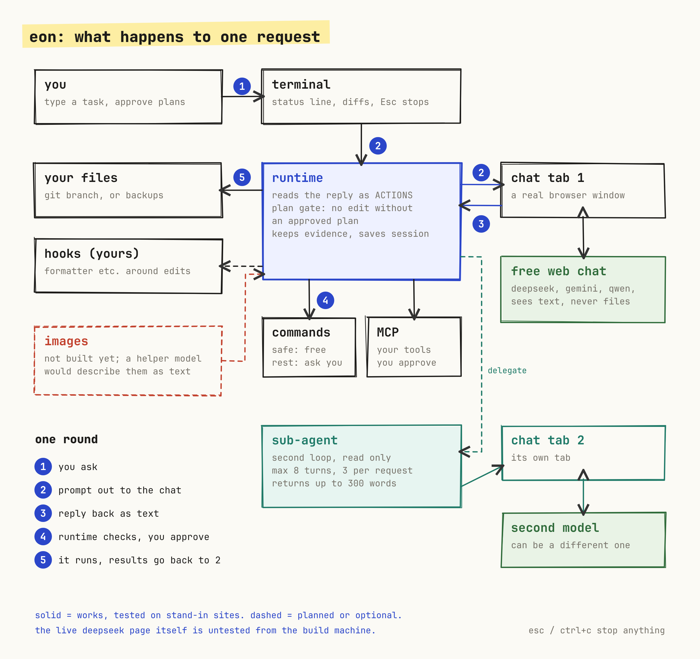
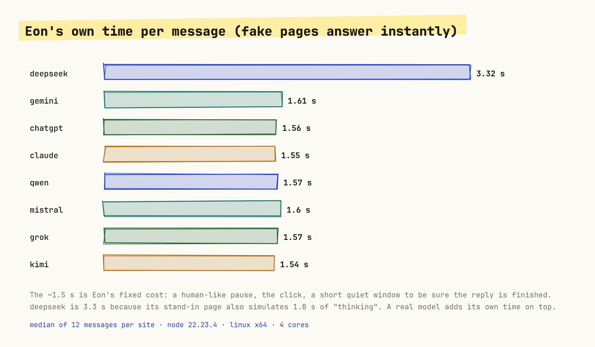
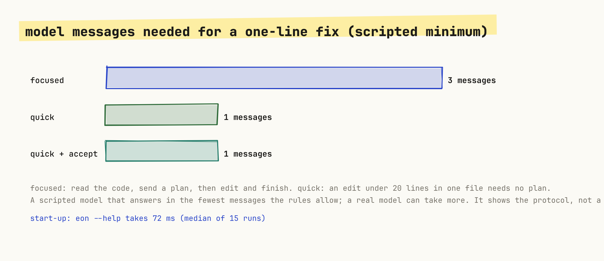

<p align="center"></p>

<h1 align="center">Eon</h1>

<p align="center"><b>A coding agent for your terminal that runs on free web chats.</b><br>No API key. It plans before it edits, and every claim carries its evidence.</p>

<p align="center">
<a href="https://github.com/kyoubitt/eon/actions/workflows/ci.yml"></a>
<a href="https://github.com/kyoubitt/eon/releases"></a>
<a href="LICENSE"></a>
</p>


## Why Eon

- **Free.** It drives the chat sites you already use (DeepSeek, Gemini, ChatGPT, Claude, Qwen, Mistral, Grok, Kimi, any site you add) or a local model. No API key.
- **Safe by construction.** The model cannot edit until you approve a plan. That rule, the permission prompts and the secret redaction are code, not instructions to the model.
- **Reversible.** Every change is on its own git branch (or backed up if there is no git): `/diff`, `/undo`, `/discard`.
- **Honest.** Claims are tagged fact, inference or assumption with a pointer to evidence; confidence is computed, and only a check or a person can mark something verified.

## Install

**Windows:** unzip the download and double-click **`install.bat`**.

**Mac / Linux:**

```bash
curl -fsSL https://raw.githubusercontent.com/kyoubitt/eon/main/install.sh | sh
```

Both install Node.js and Git if missing, set Eon up and add the `eon` command. By hand: Node 18+, Git, then `npm run setup`.

## Use

```bash
eon login      # once: log in to DeepSeek in the window that opens
eon check      # confirm it works end to end
cd my-project
eon            # start, then type a task
```

Eon reads your code, shows a plan with the evidence behind each claim, and edits only after you approve.

| | |
|---|---|
| **Modes** | `guided` approve each step · `accept` approve the plan once · `research` read-only · `autonomous` works alone in a worktree |
| **Models** | `--model deepseek,qwen,chatgpt` falls back to the next at a usage limit; `eon setup-local` for a local model |
| **Skills** | 17 recipes (`/fix-bug`, `/tdd`, `/security-review`, `/ui-work` …); write your own with `/skills new` |
| **Brief** | a short request gets the fitting skill, likely files and your test command added, locally; `--rewrite` lets the model restate it first |
| **Extensions** | read-only sub-agents, MCP servers (`eon mcp add`), hooks, pictures (`@shot.png`) |
| **Memory** | `EON.md` files and lessons learned from earlier mistakes |
| **Resilience** | Esc and Ctrl+C always work; checks and logouts are noticed; a cut-off session offers to resume |
| **Fast mode** | `eon --fast`: quick level plus accept mode, fewer round trips for small jobs |

**Type `/`** to see every command and skill; keep typing to filter (`/sec` finds `security-review`), ↑ ↓ to scroll, Tab or Enter to pick. `/help` lists the everyday commands, `/help all` the rest. Maintenance: `eon update`, `eon doctor --fix`, `eon export`.

## How it works



The plan gate, where Eon keeps its files, and how it handles limits and checks are explained with pictures in **[docs/architecture.md](docs/architecture.md)**. In short: every request is a folder of plain files in `.eon/tasks/` (messages, actions, plan, progress), memory is plain markdown you can edit, and nothing depends on the chat site remembering anything.

## Numbers

<p> </p>

Eon's own overhead on built-in stand-in pages (no model time): about 1.2 s per message, 70 ms start-up, 3 model messages for a one-line fix at focused level and 1 at quick level. These measure Eon, not any model; method, caveats and what is *not* measured are in **[docs/benchmarks.md](docs/benchmarks.md)**.

## Questions

**Will this get my account banned?** It can. Eon automates a website with your own login, and many sites' terms forbid automated use. This has already happened once: a DeepSeek account was suspended for a few days after a burst of test runs and a human check (the exact trigger is unknown; the site does not say). So Eon is built to be a light, polite client rather than a clever one: it sends one message at a time in one chat per task, uses your own Chrome when you have it, hides nothing about being automated (no spoofing, no rotating accounts), and hands every human check to you. It stops for good at a check that keeps returning or at any suspension notice, sends nothing more to that site, keeps count of today's messages and asks before a very busy day, slows down after failures, and refuses to repeat `eon check`, `eon harness` and `eon inspect` within 10 minutes. Anything that adds extra messages (`--rewrite`, sub-agents, a picture helper, MCP) is off until you switch it on (`eon features`). It still cannot promise a site will not object: use an account you can afford to lose, keep live tests few, or use a local model (`eon setup-local`), which has no account at risk. If something does get flagged, `eon bisect` helps find which switch to blame.

**Do MCP servers, skills and hooks change that?** No. They run on your computer and never touch the chat site. Only extra *messages* (sub-agents, the picture helper, `--rewrite`) add to what a site sees.

**Does Eon log in to GitHub or push anything?** Never. Everything is local; git is optional.

**What does it send, and where?** Your messages and the files you let the model read go to the chat site you chose. It also fetches pages you approve and, once a day, asks GitHub for a newer version (`/config update-check off`).

**What if a site changes its page?** `eon harness <site>` shows which of five checks fails, with a fix hint, and `eon inspect <site>` writes the page's structure (no text) to paste into an issue.

## Testing a site

```bash
eon harness deepseek     # five short messages on the real site: pass/fail each, a report to paste
eon harness --stand-in   # the same scenarios on built-in fake pages for all 8 sites (no login)
```

## Status

Tested against fake pages for all 8 sites, scripted models, a real terminal and a real browser (127 tests). A real DeepSeek run on Windows passed its end-to-end check; the other sites are untested live. See [CHANGELOG.md](CHANGELOG.md).

## More

[Full guide](docs/guide.md) · [Architecture](docs/architecture.md) · [Benchmarks](docs/benchmarks.md) · [Contributing](CONTRIBUTING.md) · [Security](SECURITY.md)

Licensed under the [GNU AGPL v3](LICENSE) or later: use, change and share Eon freely; if you distribute it or run a modified version as a network service, share your source under the same license.
