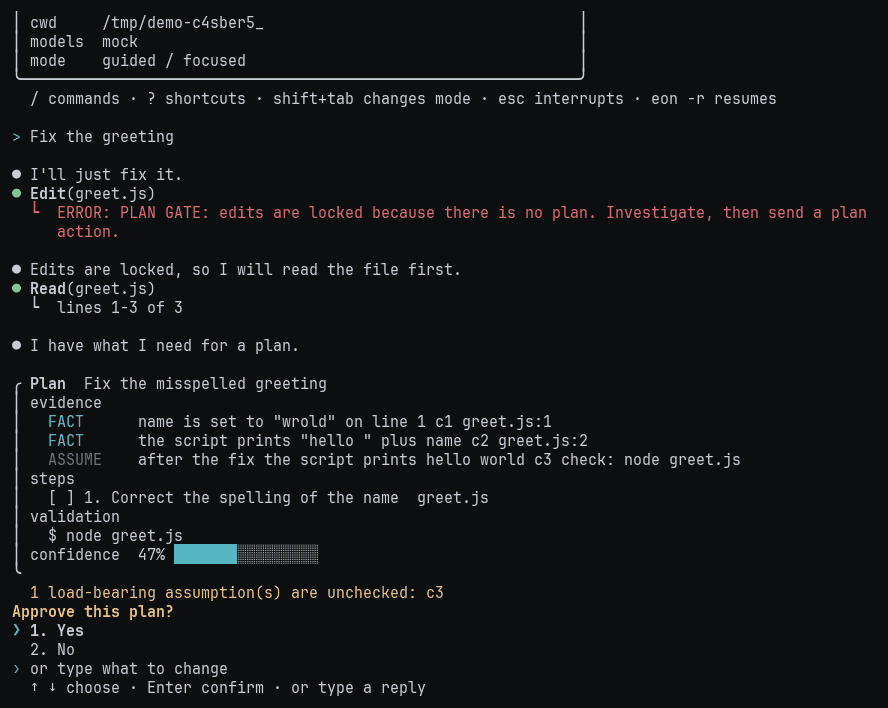

<p align="center"></p>

# Eon

[](https://github.com/kyoubitt/eon/actions/workflows/ci.yml) [](https://github.com/kyoubitt/eon/releases) [](LICENSE)

A coding agent for your terminal that runs on **free web chats** (DeepSeek, Gemini, ChatGPT, Claude, Qwen, Mistral, Grok, Kimi, or any site you add). No API key. The model does the thinking; a local program does the acting and enforces the rules. **Eon plans before it edits.**




## Install

**Windows:** download the repo as a zip, unzip it, and double-click **`install.bat`**.

**Mac / Linux:**

```bash
curl -fsSL https://raw.githubusercontent.com/kyoubitt/eon/main/install.sh | sh
```

Both install Node.js and Git if missing, set Eon up, and add the `eon` command. By hand: Node 18+, Git, then `npm run setup`.

## Use

```bash
eon login      # once: log in to DeepSeek in the window that opens
eon check      # confirm it works end to end
cd my-project
eon            # start
```

Type a task. Eon reads your code, shows a plan with the evidence behind each claim, and edits only after you approve. Every change lands on its own git branch (or is backed up if there is no git), so `/undo` and `/discard` always work.

## What it does

- **Plan gate.** No edit without an approved plan. Claims are tagged fact, inference or assumption, and confidence is computed, not claimed.
- **Many models, one chain.** `--model deepseek,gemini,qwen` falls back when one hits its limit. Local models work too (`eon setup-local`).
- **Modes.** `guided` (approve each step), `accept` (approve the plan only), `research` (read-only), `autonomous` (works alone in a worktree).
- **Sub-agents, MCP servers, hooks.** Read-only helpers in their own chat tab, any MCP tool server (`eon mcp add`), and your own commands around edits.
- **Pictures.** `@screenshot.png`; models that cannot see get a description from one that can.
- **Skills.** Short recipes the model loads when a task matches (17 come built in: `fix-bug`, `tdd`, `add-tests`, `review-changes`, `security-review`, `simplify`, `refactor-safely`, `debug-ci`, `find-regression`, `performance`, `upgrade-deps`, `write-docs`, `commit-message`, `plan-feature`, `explain-code`, `ui-work`, `accessibility-audit`). Run one with `/fix-bug the login test fails`, or write your own with `/skills new <name>`. A recipe up front means fewer wasted round trips.
- **Short requests become full briefs.** Type "fix the login bug" and Eon, locally and with no extra model call, adds the skill that fits, the files a search says are most likely involved, and the command that proves the fix (your test command). You see one line saying what was added (`brief added: skill fix-bug · 2 likely files · check: npm test`). Turn it off with `/config brief off` or `--no-brief`. For vaguer requests, `--rewrite` goes further: the model first restates your request as a goal, scope and "done when" checks, you approve or edit it, and then the work starts (one extra message; `/config rewrite on` to keep it on).
- **Fast mode.** `eon --fast` uses quick level and accept mode: small edits skip the plan, so a small job takes a few messages instead of many.
- **Memory and lessons.** `EON.md` and memory files, plus rules it learns from its own mistakes.
- **Safe by default.** Refuses your home folder, asks before commands, redacts secrets, never logs in to GitHub and never pushes.
- **Never stuck.** Esc and Ctrl+C always work; human checks and logouts are noticed and continued; crashed sessions offer to resume.

Useful commands: `/plan` `/diff` `/undo` `/usage` `/raw` `/export` `/model` `/compact` `/resume` `/check` `/help`.

Maintenance: `eon update` (newest version; Eon also mentions a new one at most once a day, turn off with `/config update-check off`), `eon doctor --fix` (repairs stale locks, damaged settings, a missing browser), `eon export` (a session as a markdown report).

## Testing a site

```bash
eon harness deepseek     # five short test messages on the real site; pass/fail for each, a report to paste
eon harness --stand-in   # the same five scenarios against built-in fake pages for all 8 sites (no login)
```

The five scenarios are: send and read a reply, a long reply (400 lines), a code block read as an action, an edit block with tabs and quotes, and a follow-up in the same chat. Each line says what is wrong and how to fix it. The report (`~/.eon/harness-<site>.txt`) holds timings and counts only, never the page's text.

## Honest notes

- It drives real chat pages in a browser, so it can break when a site changes. `eon teach <site>`, `eon inspect <site>` and `eon doctor --report` help fix that.
- Free chats throttle heavy use, and automating them may be against a site's terms.
- Tested against stand-in pages and scripted models on Linux. A real DeepSeek run on Windows passed its end-to-end check; the other sites are untested live.
- Token counts are estimates (characters ÷ 4).

## More

Full guide: [docs/guide.md](docs/guide.md) (every command, mode, setting and limit).

```bash
npm test      # unit tests; browser tests run when Playwright is installed
```

Licensed under the [GNU AGPL v3](LICENSE) (or later): you can use, change and share Eon freely, but if you distribute it or run a modified version as a network service, you must share your source under the same license.
