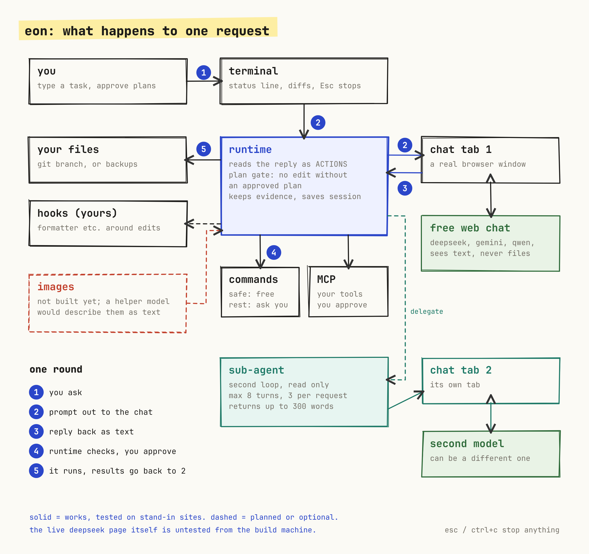
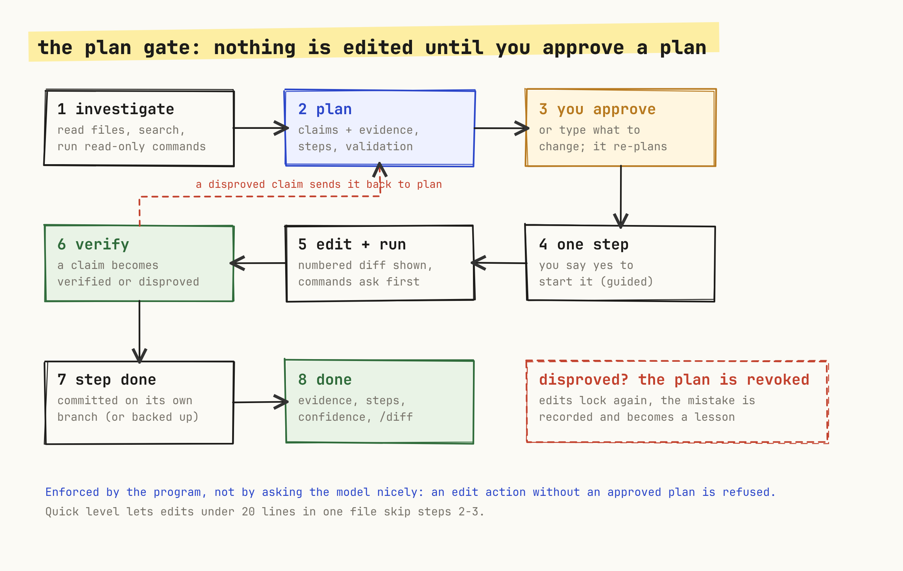
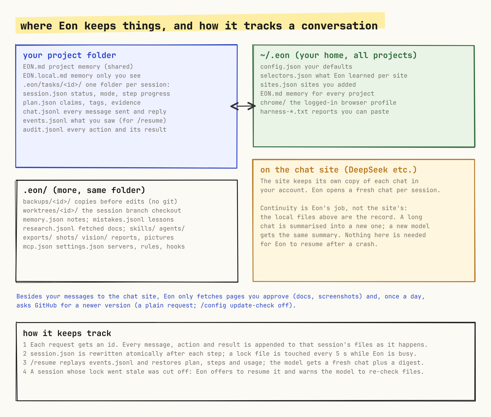
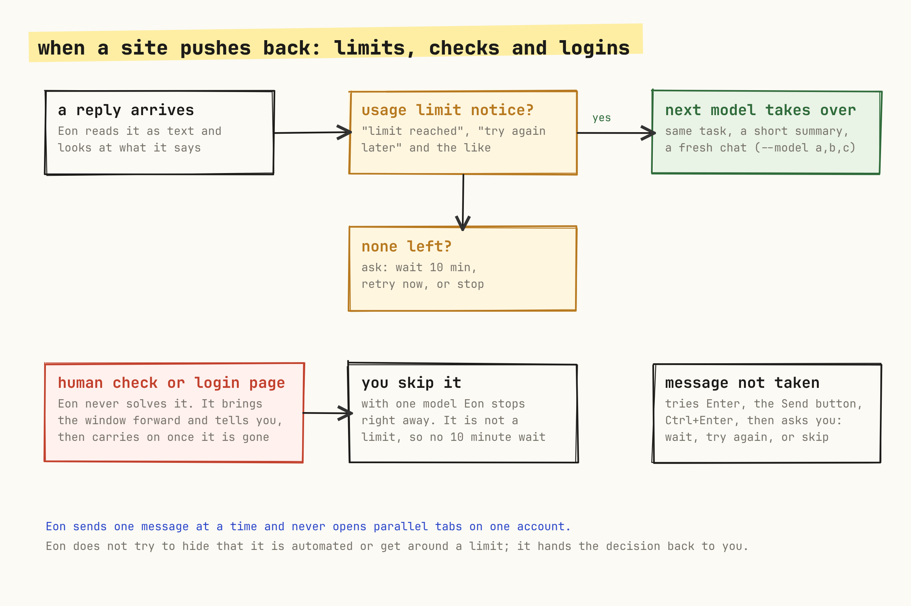

# How Eon works

Eon is a local program that sits between you, your project and a free web chat. The chat site only ever sees text; Eon reads the project, runs commands, enforces rules and keeps the record.

## One request, step by step

1. You type a task. Eon adds a short **brief** locally: the skill that fits, files a search points at, and your test command (optionally the model restates the request first: `--rewrite`).
2. Eon sends the model its instructions, the file list and your request, through a real browser window you are logged in to.
3. The model answers in text. Eon reads **actions** out of the reply (`read_file`, `search`, `run`, `plan`, EDIT/WRITE blocks, `done`, and a few more).
4. Eon decides what each action may do: the **plan gate** (no edit without an approved plan), permissions (commands ask first), secret redaction, hooks.
5. Eon runs what is allowed and sends the results back. Repeat until `done`.

## The plan gate

The gate is code, not a request to the model: an edit action without an approved plan is refused, and a plan whose claim is **disproved** by a check is revoked. Claims carry a tag (fact, inference, assumption) and a pointer to evidence; confidence is computed from those, never claimed. Only a person can mark a claim *verified*; in autonomous mode it is *checked* instead.

## Where things are stored, and how a conversation is tracked

- **The chat site keeps its own copy** of each chat in your account. Eon opens a fresh chat per session and does not depend on the site to remember anything.
- **Eon's record is local.** Each request gets an id and a folder `.eon/tasks/<id>/` with `session.json` (status, mode, step progress, usage), `plan.json`, `chat.jsonl` (every message sent and every reply), `events.jsonl` (what you saw, so `/resume` can replay it) and `audit.jsonl` (every action and its result).
- **Memory** is plain files you can read and edit: `EON.md` (project, shared), `EON.local.md` (only you), `~/.eon/EON.md` (every project), plus `.eon/memory.json` notes and `.eon/mistakes.jsonl` lessons that are shown to the model when they apply.
- **Edits** go on their own git branch in a separate worktree (`.eon/worktrees/<id>/`), or, without git, are backed up first (`.eon/backups/<id>/`).
- **Resuming and crashes.** `session.json` is written atomically after each step and a lock file is touched every 5 seconds while Eon works. If the lock goes stale the session was cut off; the next start offers to resume it, and the model is told to re-check the files it touched. A long chat is summarised into a new one; a different model gets the same summary.

## Limits, checks and logins

Eon sends one message at a time and hands every decision about checks and limits back to you. It does not solve checks, rotate accounts or hide that it is automated beyond what a normal browser does.

## Extensions

- **Skills**: recipes in `skills/` (built in), `~/.eon/skills`, `.eon/skills`.
- **Sub-agents**: a read-only second loop in its own chat tab (`delegate`), at most 3 per request.
- **MCP servers**: tools you connect (`eon mcp add`); started and called only after you allow them.
- **Hooks**: your commands around edits and runs.
- **Pictures**: sent to models that can see, or described by a helper model for DeepSeek.

All of these run on your computer or go through Eon's rules; none of them talk to the chat site by themselves, except sub-agents and the picture helper, which send extra messages.
