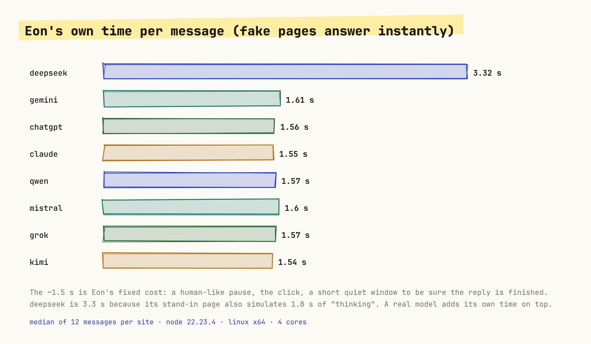
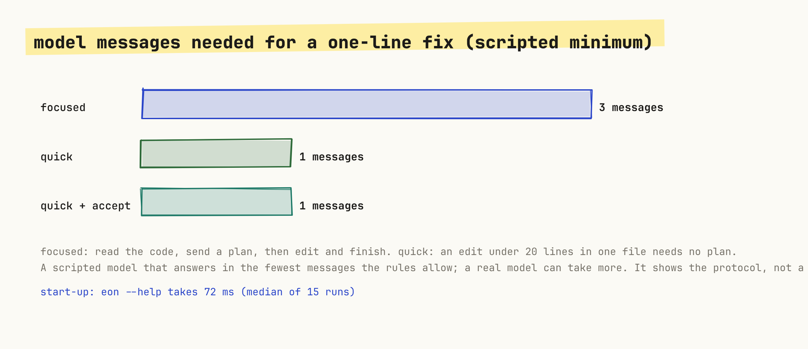

# Numbers

These are measurements of **Eon itself**, not of any model. Chat sites and models are outside this repository, so their quality and speed are not measured here.

## What is measured, and how

`node tools/bench.mjs` (then `python3 tools/charts.py` for the pictures) runs on the built-in fake chat pages, which answer instantly, so what is left is Eon's own waiting and polling.

| measure | result | how |
|---|---|---|
| start-up (`eon --help`) | **72 ms** median | 15 runs |
| driver time per message | **about 1.5 s** on 7 of 8 stand-in sites, 3.3 s on the DeepSeek stand-in | median of 12 short messages per site; the DeepSeek page also simulates 1.8 s of "thinking" |
| model messages for a one-line fix | **3** at focused level, **1** at quick level | a scripted model that answers in the fewest messages the rules allow |
| automated tests | **127** (unit, real terminal, real browser) | `npm test` |

Machine: Linux x64, 4 cores, Node 22. Re-run on yours; the figures move with the machine.

## What they mean in practice

- A task of *N* messages costs about *1.5 s × N* of Eon overhead plus the model's own time. Most of a real run is the model writing its reply, which Eon cannot speed up. What Eon can do is need fewer messages: skills and the task brief put the recipe in the first message, and `--fast` skips the plan for small edits.
- The 1.5 s is deliberate: a short human-like pause, the click, and a quiet window so a reply that is still being written is not cut off. It is not a limit of the browser.

## What is not measured

- Anything on a real site (the live DeepSeek page is untested from where this was built). `eon harness deepseek` measures the same five scenarios on your machine and writes a report.
- Model quality: whether a model plans well or edits correctly. That depends on the model you choose.
- A comparison with other agents. Different models and tasks make such numbers misleading, so none are claimed.

## An honest note on one change

Version 0.7.0 made Eon wait for a Send button to wake up instead of falling back to Enter. In tests with very short pauses this removed an occasional 5 s stall on sites where Enter does not send. At the normal pace the medians are the same before and after (1.5 s), so it is a safety net, not a speed-up.
