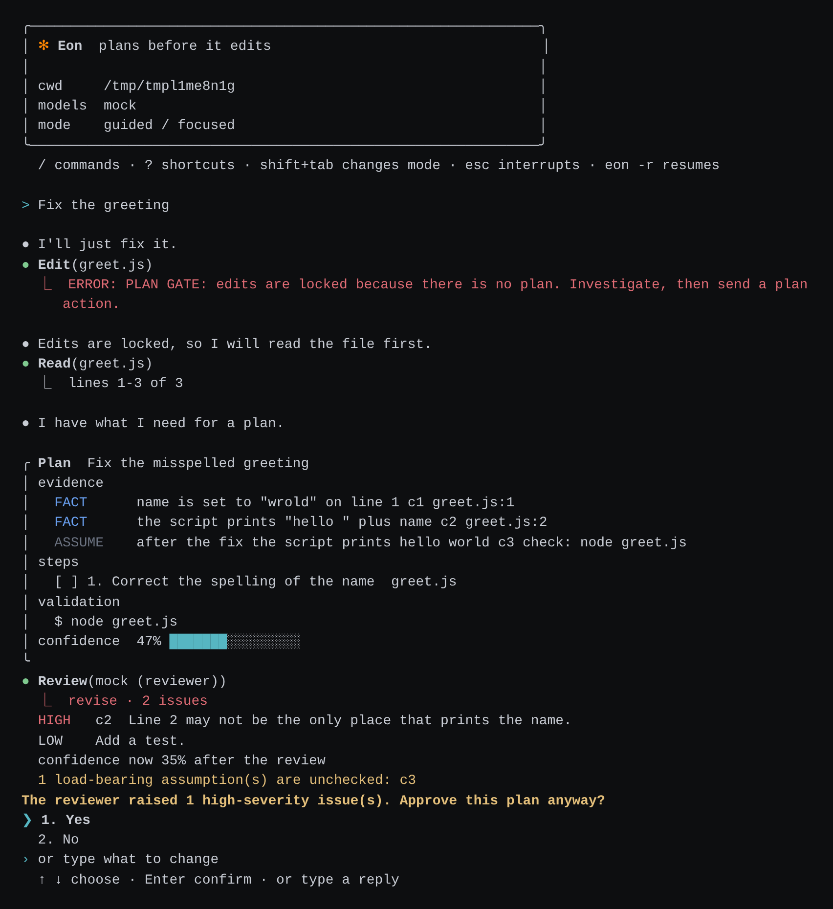
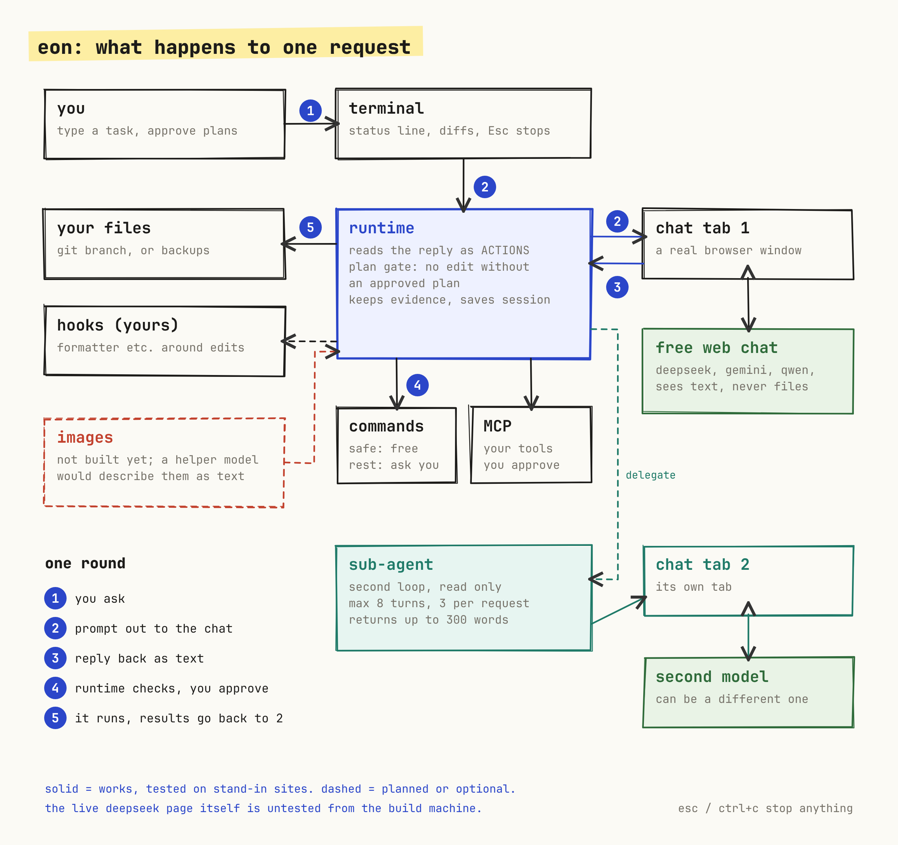

# Eon

A coding agent for your terminal that runs on free web chats: DeepSeek by default, or Gemini, ChatGPT, Claude, Qwen, Mistral, Grok, Kimi, or any site you add. It needs no API key. The model does the thinking; a local program does the acting and enforces the rules, so the model cannot skip them. Eon plans before it edits.



## Install

**Windows (one click):** unzip the folder, then double-click **`install.bat`**. It installs Node.js and Git if they are missing (using winget; Windows may ask you to allow it), installs Eon, puts the `eon` command on your PATH, adds an "Eon" shortcut to your desktop and runs a quick check. Then open a **new** terminal.

**Mac and Linux:** in the unzipped folder run

```bash
sh install.sh
```

It needs Node.js 18+ and git; on a Mac with Homebrew it installs Node for you, otherwise it tells you exactly what to install. If `npm link` is not allowed on your machine it writes a small launcher to `~/.local/bin/eon` instead.

**Download and install in one line** :

```bash
curl -fsSL https://raw.githubusercontent.com/kyoubitt/eon/main/install.sh | sh
```

**By hand** (what the installers do): install Node.js 18+ and Git, then inside the folder run `npm run setup`.

### First run (about five minutes)

1. Log in to DeepSeek once. Eon opens your own Chrome as a normal window; log in there and press Enter.

```bash
eon login
```

2. Check that it works end to end. This sends three real messages: one to test sending, one to read a reply, and one asking the model to create a file through Eon.

```bash
eon check deepseek
```

3. If a stage fails, the output names the fix. If it still fails, make a report with no code or secrets in it and paste it to whoever is helping you:

```bash
eon doctor --report
```

4. Go to a project folder and start:

```bash
eon
```

## Can the web model edit my files?

Not by itself. A web chat cannot touch your computer. Eon does the editing: the model writes its actions as text in its reply, Eon reads them from the page, checks them against the rules and applies them. Edits and new files use plain blocks, so no code has to be escaped inside JSON:

```
EDIT step=1 path=src/login.js
<<<<<<< SEARCH
redirect(req.session.next);
=======
redirect(req.session.next ?? "/home");
>>>>>>> REPLACE
```

If a reply is malformed, Eon tells the model exactly what is wrong (for example the JSON error and where) and asks again. Edits tolerate Windows line endings, trailing spaces and a byte-order mark, and keep the file's own line endings.

`eon check <site>` proves the whole path on your machine. It has been tested against a stand-in chat site in a real browser, including streaming replies, Send buttons and a human check, but not against the live sites, because they need your login.

## Use

Go to your project folder and start it:

```bash
eon
```

| Command | What it does |
|---|---|
| `eon` | Start a session in this folder. |
| `eon "fix the login redirect"` | Start with a first task. |
| `eon -r` | Pick a past session from a list and carry on. `eon -r 2` or `eon -r <id>` names one. |
| `eon -c` | Continue the most recent session. |
| `eon -p "task"` | One task with plain output, then exit. With `--output-format json` it prints one JSON result (needs `--mode autonomous` or `research`, because nothing can be asked). Add `--stdin` to include piped text: `git diff \| eon -p "review this" --stdin`. |
| `eon login [site]` | Log in to a chat site once. |
| `eon sites` | List the chat sites Eon knows. |
| `eon check <site>` | Test a site end to end (add `--no-edit` to skip the file-edit stage). |
| `eon teach <site>` | Show Eon where a site's message box, Send button and replies are, by clicking them. |
| `eon inspect <site>` | Log in, send one test message and write `~/.eon/inspect-<site>.txt`: the structure of the chat area (tags, classes, attribute names) with **no page text and no sidebar contents**, marking what Eon took for the box, Send button and replies. Paste it to get a site working. |
| `eon doctor [--report]` | Check this machine; `--report` writes a text file you can paste to ask for help (it includes your saved selector values, which are page structure, not secrets). |

### Git is optional, and Eon never logs in to GitHub

Eon never logs in to GitHub, never pushes and never talks to any git server; everything is local. In a folder that is not a git repository it offers three choices: make it a repository here, **work without git**, or research only (read and answer, no edits).

- **With git** (best): every step is a commit on its own branch, so `/diff`, `/merge`, `/undo` and `/discard` all work.
- **Without git**: Eon copies each file to `.eon/backups/<session>/` before it first changes it. `/diff` compares with those copies, `/undo` puts back the last step, `/discard` puts back every file. Nothing is committed. Autonomous mode needs git.
- **Protected folders**: Eon will not create a repository, or edit files, in your home folder, a drive root, a system folder, or your Desktop, Documents or Downloads folder themselves (a project *inside* them is fine), and it will not make a first commit in a folder with more than 2,000 files. It says so and switches to research mode once, instead of asking again on every message. A stale `index.lock` is explained in plain words.
- `eon gui` no longer exists; just run `eon`.

### First start, and when Eon is cut off

- **First start:** the first time you run `eon` it checks this computer and prints one line each (Node, git, Chrome or Edge, whether you are logged in to the chat site, a local model, whether the folder is a real project, whether `~/.eon` is writable), with the exact fix for anything wrong. If you are logged in it offers to test the site (a few short messages). Run it again any time with `/check` or `eon first-run`.
- **Cut off:** while Eon works it touches a small lock file every few seconds. If Eon dies (crash, closed window, power cut) the session is left marked as working with a stale lock, and the next start in that folder asks: resume it, start fresh, or later. Resuming tells the model the last step may be half-done and shows it `git status` of the task branch (or the files the backup step touched), so it checks before going on. A live Eon in another window is never offered. `/resume` lists such sessions as "cut off".

### Esc, Ctrl+C and waiting

Esc stops the current run at the next safe point, even in the middle of a wait (a usage-limit wait, a slow reply, the pause between messages). Ctrl+C does the same; Ctrl+C twice within two seconds leaves Eon. If a site shows a human check or you are logged out, Eon says so, and **carries on by itself** as soon as the check is gone and the chat box is back. Skipping a check or a login is not treated as a usage limit: with no other model the run just stops and says why. Only a real "limit reached" notice puts a model to rest.

### Intro screen

Starting `eon` in a terminal shows a full-screen intro (the DeepSeek whale for DeepSeek, a small robot tinted for the model in use for the others) for about a second and a half, or until you press a key. It is skipped on small terminals (under 60×20), when piped and with `-p`. Turn it off with `--no-splash` or `/config splash off`.

### The screen

It works like a chat in your normal terminal, so everything stays in your scrollback.

- Your messages and the model's replies (rendered as markdown), with each tool call as a `●` row and its result under `⎿`. Edits show as numbered lines with context, removed lines in red and added lines in green.
- The plan appears as a block with its evidence tags, steps, validation and confidence.
- Questions come as numbered choices. Press the number, use ↑ ↓ and Enter, or type a reply (for example what to change in a plan).
- A box at the bottom takes your next message, with the mode, level, model, branch and plan progress under it.
- While Eon works, the steps of the approved plan stay pinned above a spinner that says what it is waiting for ("typing the message", "sent, waiting", "DeepSeek is writing…") and shows the tail of the reply as it is written.

Keys: `/` opens the command menu (Tab completes), `?` lists the shortcuts, **Shift+Tab** changes the mode, **Esc** interrupts the work, **↑** recalls earlier messages, **Ctrl+O** shows the full output of the last tool call, **Ctrl+C** twice leaves. A bell rings when Eon needs you after you have been away for a few seconds (`/bell` turns it off).

Three prefixes: `# note` saves a note to memory (you choose where), `!command` runs a shell command yourself and tells Eon about it with your next message, and `@path` attaches a file's lines to your message (Tab completes names). **Ctrl+R** searches your earlier messages.

Multi-line messages: **Ctrl+J**, or a backslash then Enter, adds a line. Pasting several lines puts them in the box and waits for you to press Enter; it never sends half a paste. A message that starts with `/` is only a command if it is one: `/src/app.js is broken` is sent as a message.

After a task finishes, your next message continues in the same session: same chat, same branch, and the plan gate closes again until a new plan is approved. `/new` starts fresh.

### Commands

| Command | What it does |
|---|---|
| `/new` | Fresh session: new chat, new branch. |
| `/resume` | Go back to a past session. |
| `/plan` | Show the current plan and its progress. |
| `/diff` | What this session changed on its branch. |
| `/merge` | Keep the work: merge the session's branch into your checkout. |
| `/undo` | Take back the newest committed step (or, without git, the newest backed-up change). |
| `/discard` | Throw the session's work away. |
| `/pr` | A pull-request description built from the session: changes, evidence, checks. |
| `/review` | A second model reviews this session's changes and lists problems by severity. |
| `/compact` | Summarise the chat and open a fresh one (the next message carries the summary). |
| `/context` | What is using up the chat: size against the limit, messages sent, memory files. |
| `/usage` | Estimated tokens in and out per model (characters ÷ 4; web chats report no real counts or quota). Saved with the session. |
| `/raw` | The last message Eon sent and the model's raw reply, for tracing a strange result. |
| `/permissions` | Commands you always allow in this project: list, `add <rule>`, `remove <number>`. |
| `/config` | Saved settings: bell, pace, default mode, level and models. `/config pace slow`. |
| `/mode`, `/level` | Change the mode or level for the next session. |
| `/model <list>`, `/model plan\|build\|review\|research <list>` | Change models. |
| `/models` | Who does what, and who is resting after a usage limit. |
| `/memory` | Your memory files and the lessons Eon has learned. `/memory edit user\|project\|local` opens one in your editor. |
| `/research`, `/notes` | Saved documentation digests, and project notes. |
| `/learn <rule>` | Teach Eon a rule. It is enforced on tasks that share its keywords. |
| `/forget <id>` | Delete a lesson (`L2`) or research entry (`R1`). |
| `/init` | Create `EON.md` with the commands Eon found in this project. |
| `/allow <cmd>`, `/allow-host <host>` | Pre-approve a command or a documentation site. |
| `/project <folder>` | Switch to another folder. |
| `/output`, `/status`, `/bell`, `/help`, `/quit` | |

### Modes and levels

| Option | Meaning |
|---|---|
| `--mode guided` (default) | Investigate, plan, you approve, it edits on its own git branch. |
| `--mode accept` | You approve the plan; its edits then go in without asking again. Commands still ask. |
| `--mode research` | Read-only. Ends with a plan and a summary. |
| `--mode autonomous` | Works alone in a worktree. Nothing is asked of you. |

`--permission-mode default\|acceptEdits\|plan` means guided, accept and research, for anyone used to Claude Code. **Shift+Tab** cycles guided → accept edits → research, even while Eon is working. Autonomous is a different level of trust and starts a new session.

| `--level focused` (default) | Every edit needs an approved plan of at most 8 steps. |
| `--level quick` | An edit under 20 lines in one file skips the plan; you approve the diff. |
| `--level architect` | Plans of up to 15 steps with an impact table, reviewed by a second model. |
| `--allow "<cmd>"` | A command that may run without asking. Repeatable. |
| `--allow-host <host>` | A documentation site that may be fetched without asking. Repeatable. |
| `--in-place` | Use a new branch in your checkout instead of a separate worktree. |
| `--pace slow\|normal` | How human-paced the browser is. |

When a session ends, its branch is on the side. `/diff` shows it, `/merge` keeps it, `/discard` drops it. Nothing touches your files until you merge.

### Memory

Eon reads memory files at the start of every session, in three layers, later ones winning:

| Layer | File | For |
|---|---|---|
| user | `~/.eon/EON.md` | you, in every project |
| project | `EON.md` in the project (`AGENTS.md` or `CLAUDE.md` if there is none) | everyone on the project; commit it |
| local | `EON.local.md` in the project | you, in this project only; keep it out of git |

A line that is only `@docs/style.md` is replaced by that file's content (inside the project or `~/.eon` only). Add a note without opening a file: type `# always use pnpm here` and choose where it goes. `/memory` lists the files, `/memory edit project` opens one in `$EDITOR`, and `/init` makes a starting `EON.md` with the commands Eon found (package.json scripts, pytest, go, cargo, make).

On top of these files Eon keeps **lessons**: rules learned from mistakes and from `/learn`, described under "The four stores" below. There is no separate memory chat; the files are plain text you can read and edit.

Commands you choose to "always allow" are saved per project in `.eon/settings.json` and managed with `/permissions`.

## Models

Every model is a free web chat that you log in to once (`eon login <site>`). `eon sites` lists them: `deepseek`, `gemini`, `chatgpt`, `claude`, `qwen`, `mistral`, `grok`, `kimi`.

**None of these have been tested against the live sites.** Before relying on one, run `eon check <site>`. If Eon cannot find the message box, the Send button or the reply, run:

```bash
eon teach qwen
```

Eon opens the site and asks you to click the message box, then the Send button (or press Enter), then the reply, and saves what it learns in `~/.eon/selectors.json`. If a site renames its page later, run it again. To add a site Eon does not know, put it in `~/.eon/sites.json`: `{ "name": { "label": "...", "url": "...", "input": "css selector", "message": "css selector", "send": "css selector" } }`.

**Finding the page by itself.** Each site's message box, Send button and reply container is a list of candidate selectors tried in order (from what public userscripts use). If none match, Eon looks at the page instead: the message box is the large editable area near the bottom, the Send button is the control that wakes up when text arrives (so it is not mistaken for an attach button), and the replies are the new text that appears after sending. What it finds is remembered in `~/.eon/selectors.json`. A reply that arrives in pieces (a "thinking" block and then the answer) is handled: thinking text is never run as actions, and Eon waits for the answer. This is tested against stand-in pages built for each of the eight sites and for pages with no labels at all; the live sites may still differ, which is what `eon check` is for.

**Without any website: a model on your own computer.** If a site will not work for you, a free local model can: install [Ollama](https://ollama.com), then run `eon setup-local`. It finds Ollama, suggests a coding model that fits your memory, downloads it with your approval, and runs the same three checks on it (`eon check api`). Use it with `eon --model api`. A model that cannot follow Eon's action format is reported as too weak, not as a bug; small models on ordinary laptops often are, and they are slower. If Ollama is running when you start without a login, Eon offers to use it.

**Different models for different jobs.** One model can investigate and plan while another carries out the approved plan:

```bash
eon --plan-model gemini --build-model deepseek --reviewer chatgpt
```

When a plan is approved, Eon opens a chat with the build model and hands it the plan, the evidence and a summary of what was done. If the plan is later revoked, the work goes back to the planner. The handover summary is built from Eon's own records, so the receiving model has not seen the earlier conversation and may re-read files.

**When a model hits its limit.** Give a comma list and Eon moves down it:

```bash
eon --model deepseek,qwen,chatgpt
```

- Eon recognises a limit when a reply is a short notice such as "server is busy" or "you've reached your limit", or when no reply comes and the page shows such a notice.
- The limited model rests for 30 minutes and the next one takes over in a new chat, with the same handover summary.
- When every model is resting, guided mode asks whether to wait 10 minutes, retry now or stop. Autonomous mode waits 10 minutes up to three times, then stops and keeps the work on its branch.
- Limit notices are matched by wording, so an unusual one may be missed. Then Eon asks you to look at the browser window.

Any OpenAI-compatible endpoint works too, not only Ollama:

```bash
EON_API_MODEL=qwen2.5-coder eon --model api
```

Set `EON_API_BASE` for another endpoint and `EON_API_KEY` if it needs a key.

## How it connects, and looking like a normal browser user

There is no API key. Eon drives a real browser window that you log in to once. After that it puts each message in the chat box, sends it, waits until the reply has stopped changing and is not cut off in the middle of a code block, and reads the reply text from the page.

Eon tries to behave like a person using their own account:

- **Your own browser.** If Chrome or Edge is installed, Eon starts it as a normal window with its own profile (`~/.eon/chrome`) and connects to it over a local debugging port. It is not started by an automation library, so the page is not told it is automated. Without Chrome or Edge, Eon falls back to Playwright's browser with the usual automation switches turned off. Set `EON_BROWSER=playwright` to force the fallback.
- **Human pace.** Messages are pasted in one go, not typed key by key, with short random pauses and a random gap of a second or two between messages. `--pace slow` makes it gentler.
- **Hand-off, not workarounds.** If a site asks you to verify you are human, Eon stops, brings the window to the front, and asks you to solve it, or to use the next model. It does not solve checks, spoof a browser fingerprint or rotate identities.

This cannot guarantee a site will not flag automation, and automating these chats may be against their terms. If a site blocks it, use another model in the list or a local model.

**What was observed.** From the machine this was built on, seven of the eight sites could not be reached at all (its network blocks them), and the one that loaded (Claude) answered a headless automated browser with a Cloudflare "Just a moment…" check. That is the page Eon's hand-off recognises. How each site treats your own Chrome with your login has not been tested.

### When a message does not send

After pasting a message Eon checks that the whole text is in the box, presses Enter, and confirms the site took it (the box emptied, a reply appeared or generation started). If not, it tries the Send button, then Ctrl+Enter. If the site still did not take it, Eon saves a screenshot in `~/.eon/debug/` and asks: keep waiting (you pressed Send), try again, or skip this model. If the box cuts the message short, Eon lowers its message limit for that site and says so. Messages are kept under a limit (30,000 characters by default; `EON_MAX_PROMPT` or `maxChars` in `sites.json` changes it): the file list and the map are trimmed first, never the instructions.

## What the runtime enforces

- **Plan gate.** EDIT and WRITE blocks are refused until a plan is approved. Each edit must name a plan step and a file that step lists.
- **Evidence tags.** Every plan claim is a fact, an inference or an assumption. A fact needs a pointer (`file:line`, a tool result id, or a fetched document) that the runtime checks exists. The model cannot mark anything verified: it runs a command, and you confirm the result.
- **Computed confidence.** Verified counts 1, fact 0.7, inference 0.3, assumption 0, averaged over load-bearing claims. It measures how well the plan is supported, not whether it is right.
- **Disproved claims.** If you mark a claim disproved, the plan is revoked, edits lock again and the case is saved to `.eon/mistakes.jsonl`.
- **Git isolation.** Work happens on branch `eon/<task>` in `.eon/worktrees/`, one commit per step with the evidence in the message.
- **Permissions.** Read-only commands run freely. Anything else asks you first. `sudo`, `git push` and a few destructive commands never run. Secret files (`.env`, keys) are blocked and secret-looking values are redacted before anything reaches a chat.
- **Chat rollover.** When a chat gets long, Eon asks for a digest and continues in a fresh chat.
- **Fewer round trips.** Each message to a web chat costs seconds, so the model gets a map of where things are declared and can read several files in one action.
- **Crash safety.** Progress is saved as it happens. If the window closes or Eon crashes, `eon -r` resumes with the plan and finished steps intact. If the browser window is closed mid-task, Eon opens it again with a fresh chat and a summary.

## The four stores

Everything Eon knows about your project lives in `.eon/` on your disk. The web chats only carry messages.

| Store | File | What goes in | Who may write |
|---|---|---|---|
| Project | `project.md` | Durable facts and promoted rules. Given to every task. | Only with your approval, or a lesson that held twice. |
| Research | `research.jsonl` | Documentation digests, each with its source and date. Append-only. | The agent, through `fetch_doc` and the research chat. |
| Task | `tasks/<task>/` | The chat mirror, audit log, plan and transcript of one session. | The runtime. |
| Memory | `memory.json`, `mistakes.jsonl` | Mistakes and the rules learned from them. | See below. |

**Research.** The agent is told to read official documentation before planning. `fetch_doc` downloads a public https page (you approve each new site), strips it to text and saves it. A fetched document can back a fact in a plan. An answer from the research chat is that model's memory, so it can back an inference only, and the runtime rejects a plan that uses it as a fact.

**Memory.** You can teach a rule directly with `/learn <rule>`. Otherwise a lesson is saved only when three things are true: a claim was in a plan, a verify step disproved it, and the real cause was then confirmed by another verify step. You approve the rule's wording. When a later task matches the lesson's keywords, the runtime rejects any plan that does not say how the rule was addressed. Lessons that did not match by keyword are listed to the model, which can name the ones it thinks apply, and those are enforced the same way. A lesson applied in two later tasks that end well is promoted into the project notes.

## Autonomous mode

```bash
eon -p "fix the failing date test" --mode autonomous --allow "npm test"
```

- A checkpoint tag `eon-checkpoint/<task>` marks where the repository stood, and all work happens in a separate worktree.
- A plan that passes the runtime's checks is approved automatically. At architect level it must also get through the review with no high-severity issue.
- Only read-only commands and the ones you passed with `--allow` run. Everything else is denied and listed in the final report. An allowed prefix such as `--allow node` allows anything starting with it, so keep entries specific.
- Claims the agent tests are tagged **checked**, not verified. Only a person can verify.
- When the agent says it is done, the runtime runs the plan's validation commands itself and refuses to finish while they fail.
- After 3 replans or failed fixes it stops and reports, with the unfinished work kept on the branch.

Allowed test commands run code the agent just wrote, on your machine, with your user's permissions. The worktree isolates git, not the operating system.

## Plan review

At architect level, or whenever you pass `--reviewer`, each plan goes to a second model in its own browser tab. It sees the task, the plan and the lines each claim points at, and is told to find what is wrong. A high-severity issue against a fact or inference halves that claim's weight until it is checked. In guided mode you see the issues before you approve; in autonomous mode a high-severity issue sends the plan back.

## Limits you should know

- The chat site drivers are tested against a stand-in page in a real browser, not the live sites. If a site does not work, run `eon check <site>`, then `eon teach <site>`.
- The sites are free but throttle heavy use and may show a login or a check. Eon pauses and asks you to handle it in the browser window.
- Automating these web chats may be against their terms of use. Your code and command output are sent to the chat sites, and plans with code excerpts to the reviewer.
- Google often refuses logins in an automated browser, and other sites may too. Attach mode (your own Chrome) is the best chance; or pick another site.
- A fresh worktree has no `node_modules` or other untracked files. Let the agent run the install command, or use `--in-place`.
- Linux is where the automated tests run. On Windows, `eon check deepseek` has been run once by a real user and passed all three stages; the live DeepSeek page's own selectors were not known at that point, so Eon finds replies by looking at the page (run `eon inspect deepseek` to record the real structure). macOS is untested.
- Sub-agents, MCP servers and hooks have only been tested against scripted and fake counterparts.



The picture is drawn by `tools/diagram.py` (edit it and re-run to change the picture).

## Sub-agents, MCP servers and hooks

All three are off until you set them up, and all three are tested here with scripted models and a fake server, not against live ones.

**Sub-agents.** The model can send a `delegate` action: Eon opens a *separate* chat (its own browser tab, so the main chat is untouched), runs a read-only investigation of up to 8 turns, and brings back a summary of at most 300 words. The sub-agent cannot edit, cannot run anything that is not read-only, and cannot start another one. At most 3 per request, one at a time, because each costs extra messages from the free quota and long chats are throttled. Esc stops it. Define your own in `.eon/agents/<name>.md` (or `~/.eon/agents/`):

```
---
model: qwen
---
You review code for security problems. Report file:line and why.
```

Then type `@name look at the login code` to hand it a task. `/agents` lists them.

**MCP servers.** Eon is a small MCP client (JSON-RPC over stdin/stdout; no SDK). List servers in `.eon/mcp.json` or `~/.eon/mcp.json`:

```json
{"servers": {"files": {"command": "npx", "args": ["-y", "@modelcontextprotocol/server-filesystem", "."]}}}
```

Add servers from the command line: `eon mcp list` shows ready-made ones, `eon mcp add files` (or `memory`, `fetch`, `git`, `sequential-thinking`) adds one, `eon mcp add myserver node my-server.js` adds your own (`--global` for all projects), `eon mcp test <name>` starts it and lists its tools, `eon mcp remove <name>` removes it. The ready-made entries use the package names from the official MCP servers list and have not been run here.

Descriptions of every tool would not fit in a chat message, so the model first sees only server names, asks for one server's tool list, then one tool's description, then calls it. You are asked before a server starts and before each tool's first call ("always" saves it as a rule like `mcp:files:read_file`; `/permissions` lists and removes them). Results are capped, secrets are redacted and they are marked as untrusted data. Autonomous mode never starts a server or calls a tool you have not already allowed. `/mcp` lists what is configured.

**Hooks.** Commands you configure that Eon (never the model) runs at fixed points, in `~/.eon/config.json` or the project's `.eon/settings.json`:

```json
{"hooks": {"after_edit": [{"run": "prettier --write {file}", "match": "*.js"}], "before_run": "echo about to run", "before_edit": "test -f .lock && exit 1 || exit 0", "session_end": "notify-send done"}}
```

`before_edit` and `before_run` refuse the action when they exit non-zero; `after_edit` output goes back to the model; `session_end` runs when a request finishes. Project hooks are asked about once per session (a downloaded project could contain them); your own are trusted. The model cannot change these files (`.eon` is write-protected for it).

## Pictures

Attach a picture with `@screenshot.png` in your message, or `/image path` before it (png, jpg, gif, webp, up to 8 MB).

- **A model that can see** (Gemini, ChatGPT, Claude, Qwen, Mistral, Grok, Kimi, or a local vision model such as Ollama's llava with `EON_API_VISION=1`) gets the picture itself. For websites Eon finds the page's file box, even a hidden one, uploads the file, then sends your message.
- **DeepSeek's chat cannot see pictures** (it only reads the text in them). So a *helper* model that can see describes the picture in words first: exact text, layout, every element with colour and state, anything broken. That description goes to DeepSeek with your message. The helper defaults to Gemini (ChatGPT if Gemini is your main model); choose another with `--vision-model`, `/model vision <site>` or `/config vision-model <site>`. You must be logged in to it. Descriptions are saved in `.eon/vision/`, so the same picture is never uploaded twice.
- **Honest limit:** DeepSeek still never sees pixels. Fine detail can be lost, each picture costs an extra round trip and some of the helper site's free quota, and the upload step on each site's real page is untested (only a stand-in page with a hidden file box was).

The model has three actions for this: `look` (ask the helper one precise question about a picture, for example "what colour is the Save button?"), `screenshot` (a picture of a web page, taken with a browser; localhost is free, other addresses ask you first) and `inspect_page` (the page's elements with their sizes and colours as text, which a text-only model reads more exactly than any description of a picture).

## Skills and fast mode

A skill is a folder with a `SKILL.md`: a `name`, a one-line `description` saying when to use it, then the steps. Eon looks in `.eon/skills/` (this project), `~/.eon/skills/` (you) and its own `skills/` (built in); a project skill beats yours, which beats a built-in one. The model is shown only the names and one-liners; when a task matches it sends a `skill` action and receives the steps. You can also run one yourself with `/<name> <what to do>`. `/skills` lists them, `/skills new <name>` makes a starter file. A skill is guidance only: the plan gate and permissions still apply.

`eon --fast` is `--level quick --mode accept`: edits under 20 lines in one file need no plan, and when a plan is needed you approve it once. It does not shorten the pauses between messages; that is `--pace`, and a human-like pace is part of not tripping a site's checks.

## Task briefs

Before the first message of each request, Eon looks at your words and adds three things when it can, all locally (no extra model call, nothing sent anywhere):

1. **A skill.** Your request is matched against what each built-in or custom skill is for (words like fix, crash, slow, upgrade, README, button, explain). The best match's steps are put in the message so the model does not have to ask for them. A request that already says `/skill-name` is left alone.
2. **Likely files.** Up to three keywords (quoted text, code-looking names such as `checkPassword`, then longer plain words) are searched in the project; files with the most hits are listed with the first matching line. The model is told to read them before assuming.
3. **A check.** The project's test, build or lint command (found in `package.json`, `pyproject.toml`, `go.mod` and so on) is named as the way to prove the change, so the plan's validation starts from something real.

One dim line tells you what was added. It is a guess made by pattern matching, so the model is told to ignore a skill that does not fit. Off: `/config brief off` or `--no-brief`.

## Updating, exporting and repairing

- **`eon update`** updates Eon in place: a git copy is pulled, anything else is replaced from GitHub's download, never touching `node_modules` or `.eon`. At most once a day Eon asks GitHub which version is newest (a plain request, nothing about you is sent) and prints one line if yours is older. Stop it with `/config update-check off` or `EON_NO_UPDATE_CHECK=1`. It needs the repository to be public.
- **`/export [file]`** and **`eon export [number|id]`** write one markdown report per session to `.eon/exports/`: the requests, the plan with each claim's tag and evidence, steps done, commands that ran with exit codes, the diff and the result. Secrets are redacted; read it before you share it.
- **`eon doctor --fix`** (`--yes` to skip the questions) repairs what it finds: a stale `.git/index.lock`, session locks from an Eon that is gone, a damaged `~/.eon/config.json` or `selectors.json` (kept as `.bak`), a leftover browser lock, a missing browser. It asks before each fix and says "Nothing to fix" when all is well.

## Moving from Keel

Eon was called Keel. The first time you start it, the old `~/.keel` folder (your login included) and each project's `.keel/` folder (sessions, memory, research, worktrees) are moved to `.eon` automatically. Old `keel/` branches and `keel:` commits still work with `/merge`, `/undo` and `eon -r`. The old `keel` command is gone.

## Try it without a login

```bash
npm run demo
```

A scripted model fixes a typo in a throwaway folder. Answer `y` to each question.

## Tests

```bash
npm test
```

The tests include a real browser against a stand-in chat site (they skip themselves if Playwright is not installed).
